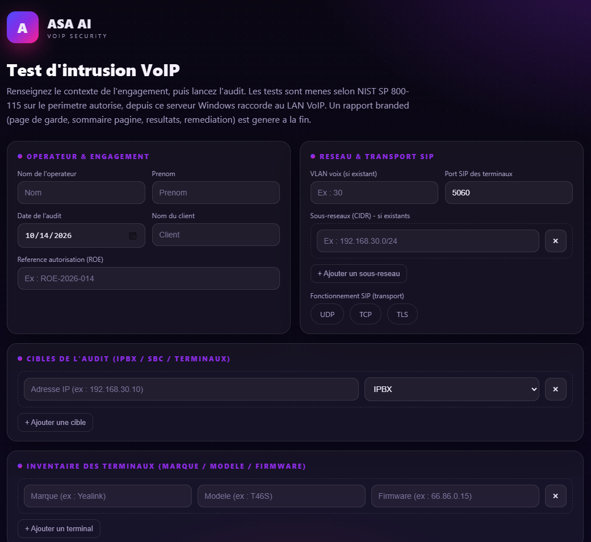
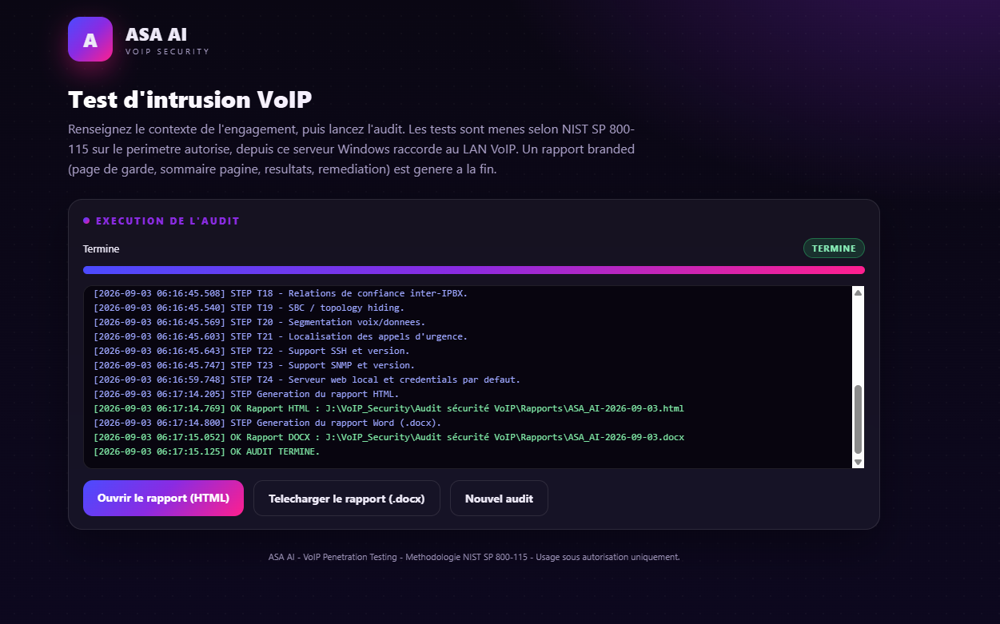
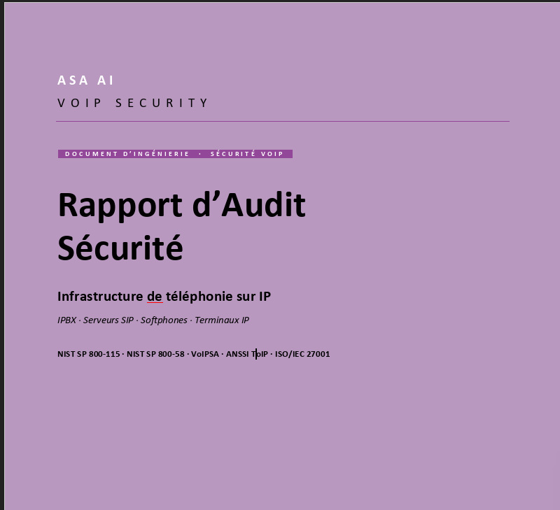

[English](README.md) · **Français**

# ASA AI — Outil d'audit de sécurité VoIP / SIP

Évaluation de sécurité non intrusive des infrastructures VoIP (IPBX, SIP, téléphones IP, SBC, softphones) selon la méthodologie **NIST SP 800-115**. Génère un rapport professionnel (HTML / PDF / DOCX) avec, pour chaque constat, la menace encourue et une remédiation priorisée par cible.

> Édité par **ASA AI** — sécurité des services VoIP.
> Contact & licences : **<contact@asa-ai.fr>** · [www.asa-ai.fr](https://www.asa-ai.fr)

---

## Aperçu

**Une interface claire — on renseigne le périmètre, on lance, on obtient un rapport professionnel.**

### 1. Saisie de l'engagement

Opérateur, périmètre autorisé (ROE), cibles IPBX / SBC / terminaux, VLAN voix, sous-réseaux, transport SIP (UDP / TCP / TLS), inventaire des terminaux.

### 2. Exécution en direct

Les 24 tests se déroulent sous vos yeux (découverte, énumération SIP, authentification, SBC, RTP, DoS…), avec journal en temps réel.

### 3. Rapport branded prêt à livrer

Page de garde premium, sommaire paginé, constats classés par sévérité, menace encourue et remédiation priorisée par cible — en HTML et Word (.docx).

---

## Licence d'utilisation

L'outil est **gratuit à l'essai, avec une limite de 5 scans**. Au-delà, une demande de déblocage s'effectue auprès de **<contact@asa-ai.fr>**.

### Obtenir un accès

1. Inscrivez-vous sur **[www.asa-ai.fr](https://www.asa-ai.fr)** (e-mail **professionnel** + téléphone requis).
2. Votre demande est validée manuellement par nos équipes.
3. Vous recevez votre **clé de licence** par e-mail.
4. Saisissez-la au premier lancement de l'outil.

Chaque clé autorise **5 scans** et est liée à un poste. Pour un quota supérieur : **<contact@asa-ai.fr>**.

---

## Installation

1. Téléchargez la dernière **[Release](https://github.com/khemegha/asa-voip-audit/releases)** (`ASA-VoIPAudit-x.y.z.zip`).
2. Décompressez dans un dossier de votre choix.
3. Lancez **`ASA-VoIPAudit.exe`**.
4. Le portail s'ouvre sur `http://127.0.0.1:8899/` (strictement local).

### Prérequis

- Windows 10/11 ou Windows Server, 64 bits.
- Poste raccordé au LAN VoIP à auditer.
- **Autorisation écrite préalable** du propriétaire des systèmes cibles (Rules of Engagement).

---

## Cadre légal

L'audit de systèmes tiers **sans autorisation écrite est illégal**. En utilisant cet outil, vous certifiez disposer d'un mandat explicite (Rules of Engagement) sur le périmètre audité. ASA AI décline toute responsabilité en cas d'usage non autorisé.

---

## Support

**<contact@asa-ai.fr>** — déblocage de quota, questions, prestations d'audit accompagné.

© ASA AI. Tous droits réservés. Le code source n'est pas distribué.
