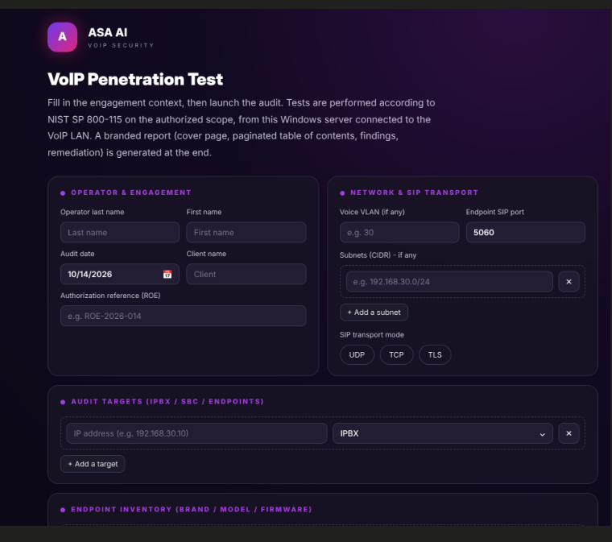
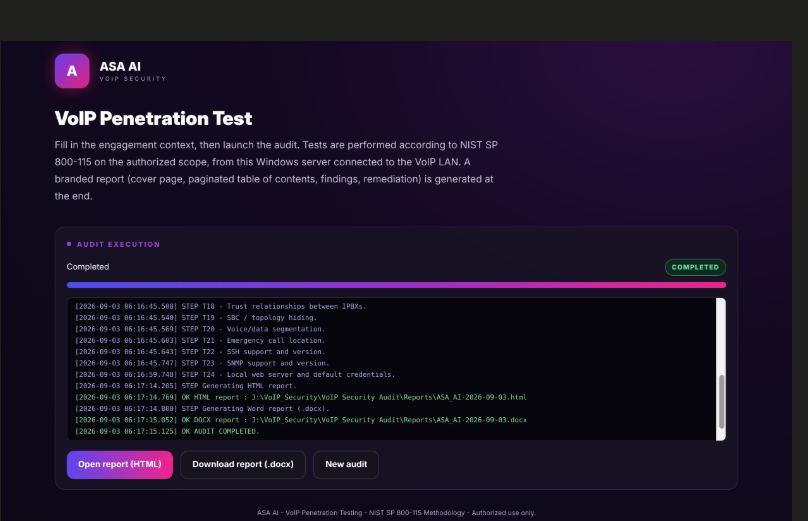
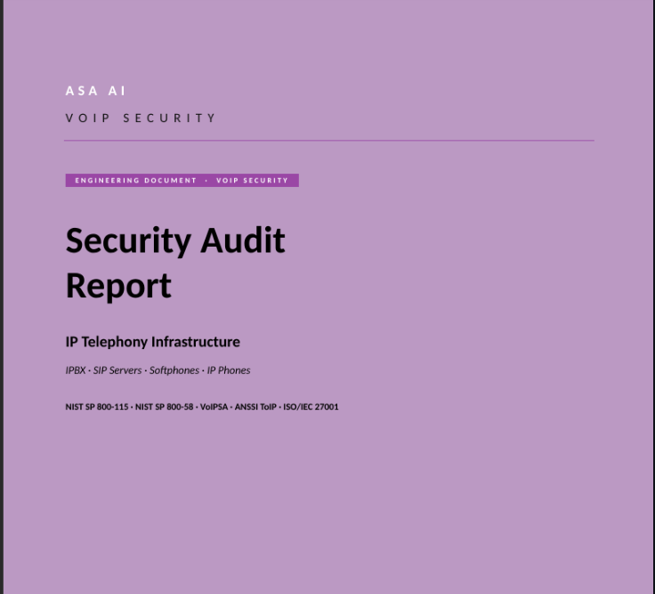

**English** · [Français](README.fr.md)

# ASA AI — VoIP / SIP Security Audit Tool

Non-intrusive security assessment of VoIP infrastructures (IPBX, SIP, IP phones, SBC, softphones) following the **NIST SP 800-115** methodology. Generates a professional report (HTML / PDF / DOCX) with, for each finding, the associated threat and a remediation prioritized by target.

> Published by **ASA AI** — VoIP service security.
> Contact & licenses: **<contact@asa-ai.fr>** · [www.asa-ai.fr](https://www.asa-ai.fr)

---

## Preview

**A clear interface — define the scope, launch, get a professional report.**

### 1. Engagement setup

Operator, authorized scope (ROE), IPBX / SBC / endpoint targets, voice VLAN, subnets, SIP transport (UDP / TCP / TLS), endpoint inventory.

### 2. Live execution

The 24 tests run before your eyes (discovery, SIP enumeration, authentication, SBC, RTP, DoS…), with a real-time log.

### 3. Branded, delivery-ready report

Premium cover page, paginated table of contents, findings ranked by severity, associated threat and remediation prioritized by target — in HTML and Word (.docx).

---

## License

The tool is **free to try, with a limit of 5 scans**. Beyond that, unlock requests are handled by **<contact@asa-ai.fr>**.

### Getting access

1. Register on **[www.asa-ai.fr](https://www.asa-ai.fr)** (**business** e-mail and phone number required).
2. Your request is manually validated by our team.
3. You receive your **license key** by e-mail.
4. Enter it the first time you launch the tool.

Each key allows **5 scans** and is bound to one workstation. For a higher quota: **<contact@asa-ai.fr>**.

---

## Installation

1. Download the latest **[Release](https://github.com/khemegha/asa-voip-audit/releases)** (`ASA-VoIPAudit-x.y.z.zip`).
2. Unzip it into a folder of your choice.
3. Run **`ASA-VoIPAudit.exe`**.
4. The portal opens at `http://127.0.0.1:8899/` (local only).

### Requirements

- Windows 10/11 or Windows Server, 64-bit.
- Workstation connected to the VoIP LAN to be audited.
- **Prior written authorization** from the owner of the target systems (Rules of Engagement).

---

## Legal notice

Auditing third-party systems **without written authorization is illegal**. By using this tool, you certify that you hold an explicit mandate (Rules of Engagement) for the audited scope. ASA AI accepts no liability for unauthorized use.

---

## Support

**<contact@asa-ai.fr>** — quota unlock, questions, assisted audit services.

© ASA AI. All rights reserved. Source code is not distributed.
